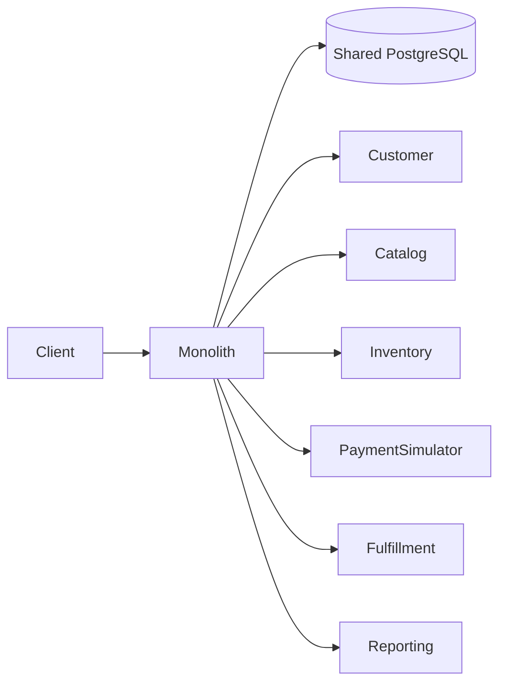

# Baseline and discovery evidence

There was no existing migration application. Workspace inventory found independent Java examples, including
`ecommerce-marketplace` using Boot 3.5.16. No applicable AGENTS.md was found. A new representative monolith was created
without altering those applications. No production runtime, incident history, deployment frequency or team readiness
data was supplied; those remain unknown.

Actual coupling: `LegacyApi.checkout` invokes `product`, reads `customers` via FK, conditionally updates stock, inserts
orders/payment/shipment/notification rows inside one Spring transaction. Failure rolls back all local mutations. Catalog
extraction introduces a remote call for immutable price snapshot; Inventory extraction removes the local stock
transaction by pausing checkout until the Saga takes over.

| Dependency                | Evidence                                 | Risk                                                      |
|---------------------------|------------------------------------------|-----------------------------------------------------------|
| Catalog to ordering       | `product()` call and price snapshot      | latency/freshness, no shared entity                       |
| Ordering to stock         | conditional SQL inside checkout          | must change transaction boundary                          |
| Ordering to customers     | FK in legacy schema                      | validate external customer reference after extraction     |
| Reporting to order data   | SQL aggregate                            | modern event projection is eventually consistent          |
| Fulfillment/notifications | synchronous inserts initially            | durable event consumer after extraction                   |
| Batch writers             | no jobs mutate products or stock in demo | audit real database roles/jobs before production transfer |
| Global cache/utilities    | none; platform is technical only         | no hidden mutable cache ownership                         |

Baseline characterization is observable HTTP plus real PostgreSQL. No runtime profiling or production bottleneck
evidence exists. See verification rather than inferring bottlenecks from names.

An additional observed coupling is direct legacy `select *` row-map API/export responses. A future legacy column
expansion requires explicit response projections first; typed modern Product mapping alone does not protect the legacy
endpoint. This remains an intentional baseline limitation, not an approved arbitrary-schema-change path.
