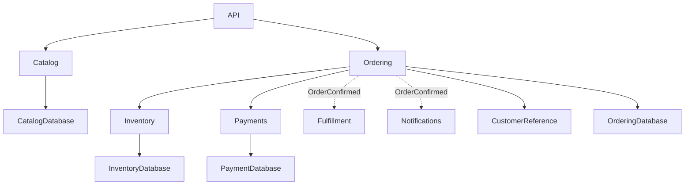

# Target and deliberately retained monolith

Catalog, Inventory, Ordering and Payment have deployable implementations. Customer, Fulfillment and Notification remain
coherent legacy modules until justified extraction; Reporting consumes a published event projection. There are no empty
services standing in for extraction.

Production target separates resource authorization, customer identity, read caching/CDN, HA databases and multi-broker
Kafka. These are future integrations, not deployed claims.
