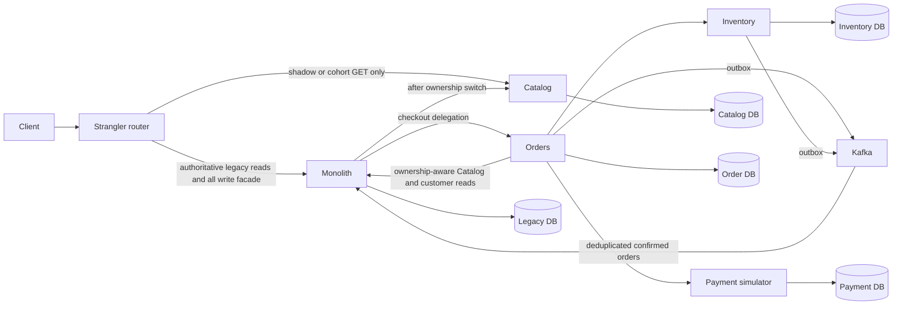

# Coexistence

Service-owned databases share one PostgreSQL process locally for cost; they are separate databases, not shared tables.
Local service runtime roles have database-scoped DML and separate Flyway migrator roles; the bootstrap superuser is
retained only for operator inspection. Production must use separate owner/migrator/runtime credentials with no
cross-database grants and restricted networks.

Ownership row shared locks cover business transactions; exclusive ownership updates drain them. Export uses
repeatable-read plus ownership share lock. Final transfer fences the source before copy and exact digest comparison,
then activates the target and only then enables delegation. Failures preserve the fence. Gateway flags affect eligible
reads only; they never determine write authority.
