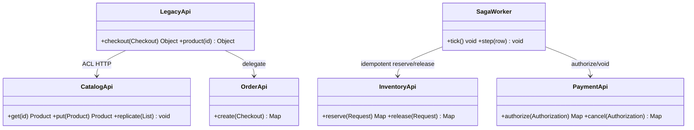
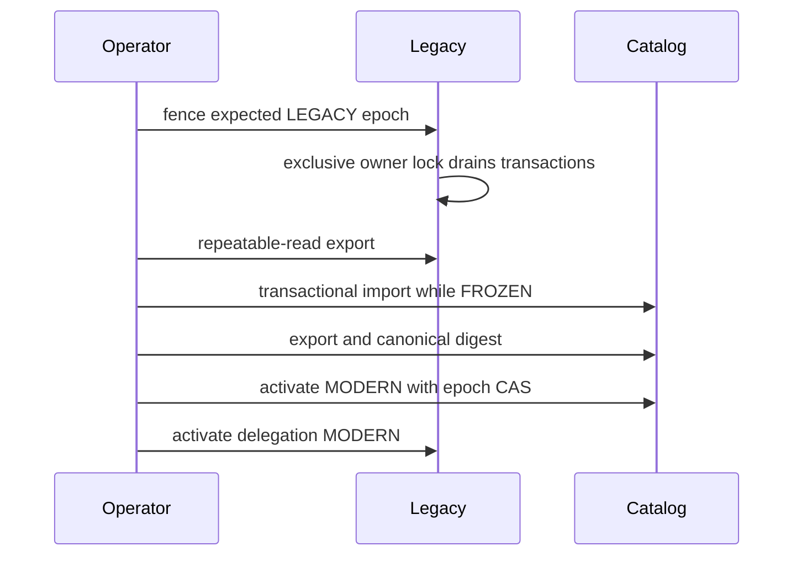

# APIs and transactions

GET /api/products/{id}: v1 exact product JSON. POST /api/products: expected `version`; updates existing IDs only,
deletion represented by tombstone. POST /api/orders: caller-supplied operation ID, customer/product/quantity; legacy
CONFIRMED or modern NEW and polling GET /api/orders/{id}. Modern order eventual states are an intentional compatibility
difference and must be client-approved. No new-product creation endpoint is claimed.

Internal POST reserve/release: `{id,product_id,quantity}`; authorize/void: `{id,amount_cents}`. Ownership CAS:
`{expected,next,epoch}`; invalid stale transitions 409. Role enforcement applies independently at every service. Exact
SQL is under each module's Flyway resources. Local transaction boundaries are annotated in controller beans; Saga worker
and relay use explicit TransactionTemplate with row locks.
