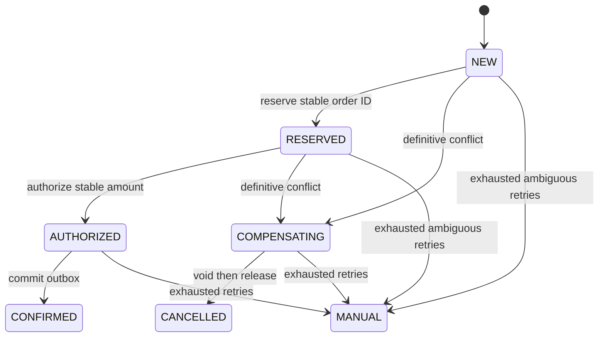

# Durable checkout

Worker claims rows using FOR UPDATE SKIP LOCKED; each state transition is durable. Remote effects may succeed before
local commit: replay uses identical reservation/payment key and amount. Ambiguous network outcomes retry the same step,
then enter MANUAL at ten failed attempts; they never conclude that a timeout means no payment. Compensation only follows
a definitive conflict. Void and release are idempotent; failed compensation remains durable and retryable. Operator
recovery POST `/internal/admin/recover/{id}?state=...` requires reviewing payment/reservation records first.

Reserve/release and authorize/void are reversible in this simulator. There is no capture or external refund API; real
captured payments need provider idempotency keys, reconciliation and durable refund states. Shipment dispatch and
external notification delivery would be irreversible effects; demo records intents only after confirmed events.

Outbox relay holds row locks while awaiting bounded broker acknowledgment, then marks published. Crash between broker
ack and DB commit can publish twice. Consumer inbox and effects share a transaction. Relay uses aggregate key, UUID
event ID, schemaVersion and type; delivery is at least once. Kafka producers are idempotent but this does not provide
business exactly once. Unpublished backlog is durable and retried, with no destructive event purge. Ordering beyond
per-key transport is not promised; future sequence-sensitive consumers must enforce aggregate versions.

Holding Saga row locks across bounded HTTP calls simplifies single-step ownership but caps throughput and occupies DB
connections. Production should use expiring fenced leases, retry backoff and deadline columns. Orchestration is chosen
for operational visibility; choreography would reduce centralized control but obscure compensation progress.

Ordering resolves product prices through the ownership-aware legacy Catalog facade throughout the rollback window. A
direct read from the frozen Catalog replica after rollback would otherwise return stale prices. Retain this ACL/control
dependency until Catalog rollback is permanently retired; only then switch the supplier port directly to Catalog.

The facade commits its ownership/legacy-ID lookup transaction before invoking modern Ordering. Otherwise concurrent
facade requests could exhaust every legacy pool connection while Ordering calls back to Customer/Catalog, causing pool
starvation. A real PostgreSQL test uses a one-connection source pool and a callback on another thread to prove the
connection is available before delegation. Legacy local checkout still uses one explicit TransactionTemplate
transaction; a foreign-key failure test proves stock rollback.

The one-connection callback test allows two connections for Flyway bootstrap, then reduces/evicts the runtime pool to
one before each assertion. Flyway initialization itself needs more than one connection when using the application pool.
